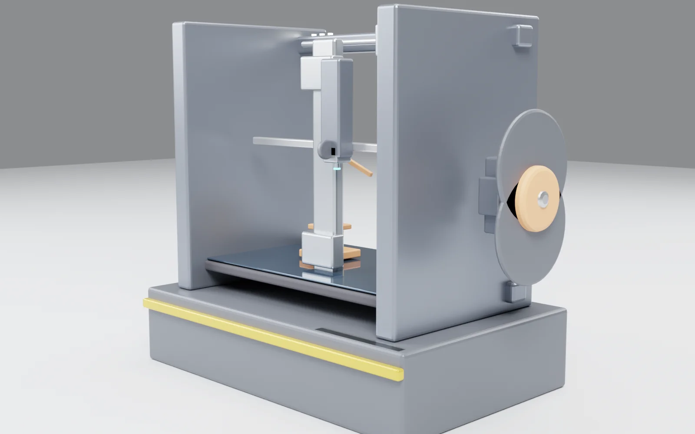

  

  This printer is not a stock photo. It is a model ILAI built from scratch in Blender, rendered locally, and verified before export.

**Most companies that use 3D printing stop at the model.** They have the CAD, they have the printer, and between the two there is always someone who has to check that the part stands up, that the dimensions are right, that the render actually shows what will be printed. That someone is time — and time is exactly what 3D printing is supposed to save you.

At Ippocra we built an ILAI specialization that covers exactly that stretch: from a model or a drawing, to a verified render and a file ready for the printer.

## From model to part: what ILAI does

Told "prepare the render of this part," the agent does this:

**Reads the model.** Takes the CAD file, the STL, or even just a drawing. Extracts the geometry, the dimensions, the tolerances. If a data point is missing, it asks. It does not invent it.

**Builds the scene.** In Blender, headless. PBR materials, lighting, camera. It is not an automatic render: the scene is composed so the part reads as it should — the surfaces that matter, the details that are needed, the true proportions.

**Renders and verifies.** The render is produced in Cycles, locally, on the machine's GPU or CPU. Then ILAI checks it: is the part whole in the frame? Is anything clipped? Does the connection between parts read as one integrated piece? If not, it corrects and retries. This is the step that makes the difference: it is not "render and ship," it is a render that *knows* it was verified.

**Exports for printing.** STL, OBJ, FBX. The file arrives at the printer in the format it needs, with geometry that has passed the check.

## Why local

3D rendering is one of those cases where local AI is not an ideological choice: it is a quality choice. A Cycles render at 64 samples requires minutes of GPU work. In the cloud, those minutes cost tokens. Locally, they cost energy and compute time — and the model, the materials, the scene stay on your file, not in a data center.

This applies to the data as well. A CAD model contains dimensions, tolerances, proprietary geometry. Sending it to the cloud for a render means sending the part somewhere you do not control. Locally, the part does not leave.

## Verification is the part that matters

A beautiful render is not a correct render. A correct render is one that shows the part as it will be printed: true proportions, the surfaces that matter, the details the client or the technician needs to see.

ILAI does not stop at the render. It verifies it. Projects the key points of the model into the image space and checks that they are where they should be. Measures brightness, variance, radial structure. If the part reads flat, if a surface does not read, if a detail is too small to be seen — it knows, and corrects.

This is the difference between a render that "looks right" and a render that has been verified. It is the same difference between an [agent](/en/agent-or-chat) and a chat: it is not speed, it is control.

## The render in the photo is the result of this process

The printer you see above was not drawn by hand. It was built by ILAI: geometry, materials, lighting, camera. The render ran locally, in Cycles, on the CPU (the GPU was occupied by another job). The STL file was exported and verified.

If you have a model, a drawing, a part to prepare for 3D printing, [let's talk](/en/contatti).
