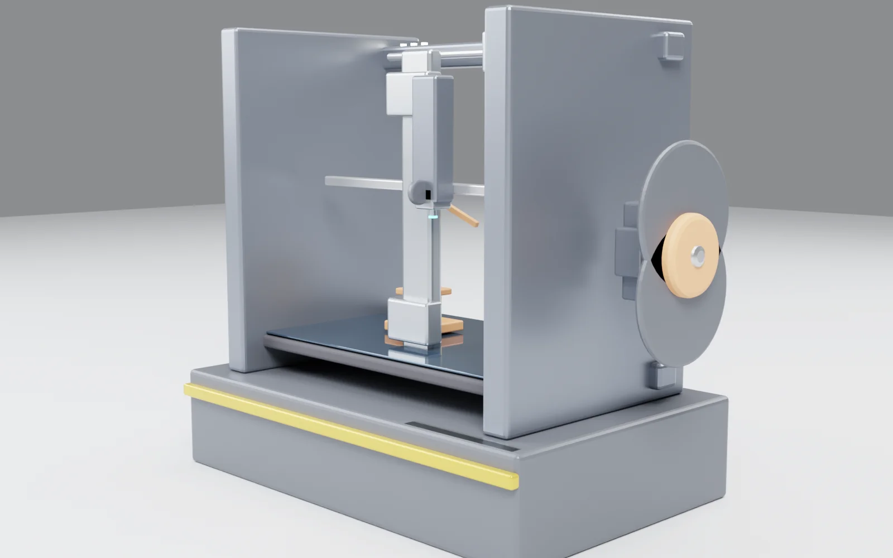

  

  Questa stampante non è una foto stock. È un modello che ILAI ha costruito da zero in Blender, renderizzato in locale e verificato prima di esportarlo.

**La maggior parte delle aziende che usa la stampa 3D si ferma al modello.** Ha il CAD, ha la stampante, e tra i due c'è sempre qualcuno che deve controllare che il pezzo stia in piedi, che le misure siano quelle, che il render mostri davvero quello che verrà stampato. Quel qualcuno è tempo, e il tempo è esattamente quello che la stampa 3D dovrebbe farti risparmiare.

Noi di Ippocra abbiamo costruito una specializzazione di ILAI che copre proprio questo tratto: da un modello o da un disegno, fino al render verificato e al file pronto per la stampante.

## Dal modello al pezzo: cosa fa ILAI

Detto "preparami il render di questo pezzo", l'agente fa questo:

**Legge il modello.** Prende il file CAD, lo STL, o anche solo un disegno. Estrae la geometria, le dimensioni, le tolleranze. Se manca un dato, lo chiede. Non lo inventa.

**Costruisce la scena.** In Blender, in modo headless. Materiali PBR, illuminazione, camera. Non è un render automatico: la scena viene composta per far leggere il pezzo come deve essere letto — le superfici che contano, i dettagli che servono, le proporzioni vere.

**Rende e verifica.** Il render viene prodotto in Cycles, in locale, sulla GPU o sulla CPU della macchina. Poi ILAI lo controlla: il pezzo è intero nel frame? C'è qualcosa di tagliato? La connessione tra le parti si legge come un insieme? Se no, corregge e ritenta. Questo è il passaggio che fa la differenza: non è un render e via, è un render che *sa* di essere stato verificato.

**Esporta per la stampa.** STL, OBJ, FBX. Il file arriva alla stampante nel formato che richiede, con la geometria che ha superato il controllo.

## Perché in locale

Il rendering 3D è uno di quei casi in cui l'AI locale non è una scelta ideologica: è una scelta di qualità. Un render in Cycles a 64 campioni richiede minuti di lavoro della GPU. In cloud, quei minuti costano token. In locale, costano energia e tempo di calcolo — e il modello, i materiali, la scena restano sul tuo file, non in un data center.

Questo vale anche per il dato. Un modello CAD contiene misure, tolleranze, geometria proprietaria. Mandarlo in cloud per un render significa mandare il pezzo in un posto dove non lo controlli. In locale, il pezzo non esce.

## La verifica è la parte che conta

Un render bello non è un render giusto. Un render giusto è uno che mostra il pezzo come sarà stampato: le proporzioni vere, le superfici che contano, i dettagli che il cliente o il tecnico devono vedere.

ILAI non si ferma al render. Lo verifica. Proietta i punti chiave del modello nello spazio dell'immagine e controlla che siano dove devono essere. Misura la luminosità, la varianza, la struttura radiale. Se il pezzo risulta piatto, se una superficie non si legge, se un dettaglio è troppo piccolo per essere visto — lo sa, e corregge.

Questa è la differenza tra un render che "sembra giusto" e un render che è stato verificato. È la stessa differenza che c'è tra un [agente](/agente-o-chat-perche-non-e-la-stessa-cosa) e una chat: non è la velocità, è il controllo.

## Il render nella foto è il risultato di questo flusso

La stampante che vedi qui sopra non è stata disegnata a mano. È stata costruita da ILAI: geometria, materiali, illuminazione, camera. Il rendering è girato in locale, in Cycles, sulla CPU (la GPU era occupata da un altro lavoro). Il file STL è stato esportato e verificato.

Se hai un modello, un disegno, un pezzo da preparare per la stampa 3D, [parliamone](/contatti).
