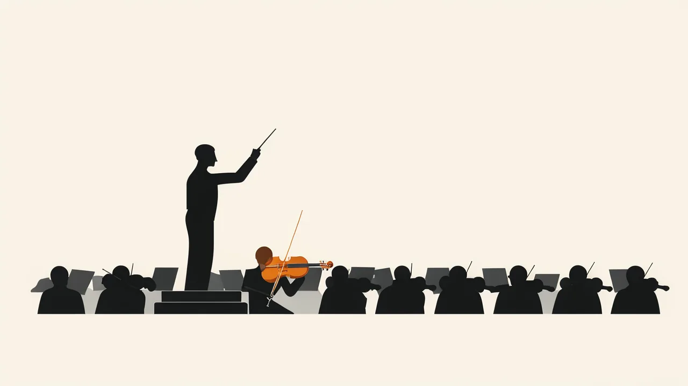

  

  Il direttore non suona. Decide il momento in cui il violino prende il solo. È così che funziona un managed agent.

# Due direzioni opposte

**Nell'agentic software, l'LLM è il driver e il codice è la sua cassetta degli attrezzi.** Il modello ragiona, decide, e chiama funzioni — il codice è una libreria specializzata che l'LLM usa per raggiungere un obiettivo.

**Nel managed agent, il verso è opposto.** Un nucleo deterministico — codice scritto per fare una cosa precisa — è il driver. E l'LLM non guida: è una subroutine che il codice chiama, nel momento esatto in cui il deterministico da solo non basta.

Non è una sfumatura. È una capovolgimento dell'architettura. Stesso modello, stesso hardware, ma chi comanda è l'altro.

# Un harness, non un framework

Il nucleo deterministico di un managed agent non è un framework. Non cerca di generalizzare. Non vuole essere riutilizzato per "qualsiasi cosa".

È un harness: stretto, su misura, costruito per fare una cosa specifica in modo affidabile. C'è un flusso di lavoro da seguire, una serie di vincoli da rispettare, un punto esatto in cui serve un giudizio che il codice non può produrre da solo. Il harness sa dove quel punto è. Chiamare l'LLM è la sua decisione, non un'eccezione.

Questa è la differenza con l'agentic software, dove il modello decide *quando* e *cosa* chiamare, in uno spazio di possibilità aperto. Qui lo spazio è chiuso: il codice sa cosa sta facendo, e chiede aiuto solo al punto in cui non può procedere da solo.

# Comportamento da modello fine-tuned, senza fine-tuning

Questo è il punto che ci tiene svegli.

Un modello fine-tuned *sa* il dominio. Le sue distribuzioni interne sono state modificate per rispondere in un certo modo, con un certo registro, per un certo compito. Ma fine-tunare costa: dati, GPU, tempo, e un modello che invecchia ogni volta che il modello di base cambia.

Un managed agent ottiene lo stesso effetto **senza toccare i pesi.** Il codice costruisce il contesto giusto, imposta i vincoli sull'output, valida il risultato, e ha un piano B se l'LLM sbaglia. Il modello non *sa* il dominio: ci viene *indirizzato*. Stesso comportamento specializzato all'uscita, zero costi di training.

È la differenza tra addestrare un musicista e dare a un musicista esperto un coperto, una partitura, e un direttore che lo tiene in pista.

# Il limite onesto

L'analogia ha un bordo, e vale la pena segnalarlo.

Un fine-tune modifica la *distribuzione* del modello: il modello cambia. Un harness non modifica nulla. Forma il contesto, valida l'output, e gestisce il fallback — ma il modello resta quello che è. Un modello fine-tuned *sa* il dominio. Un modello indirizzato da un harness *viene guidato in* il dominio.

Il che significa che un harness è buono solo quanto i suoi prompt, la sua validazione, e il suo piano di fallback. Se il modello risponde male e la validazione non lo coglie, il managed agent eredita l'errore. La resilienza non viene dal modello: viene dal codice che lo circonda.

Questo non è un difetto. È il punto. La resilienza di un managed agent non sta nel modello che è intelligente, ma nel fatto che il codice che lo chiama *sa cosa sta aspettando*, e sa cosa fare quando non arriva.

# Chi guida?

In un'orchestra il direttore non suona. Decide il momento in cui il violino prende il solo, tiene il tempo, e assicura che l'ensemble resti coeso. Il solo è del violino — ma è il direttore che lo rende possibile.

Un managed agent è un'orchestra. Il nucleo deterministico è il direttore. L'LLM è il violino. E il resto dell'ensemble è tutto il codice che fa il lavoro, ogni giorno, senza chiedere permesso.

[Correlato: [Bilbo: la sentinella sulla montagna](/bilbo-lasentinella-sulla-montagna) · [Agente o chat: perché non è la stessa cosa](/agente-o-chat)]
